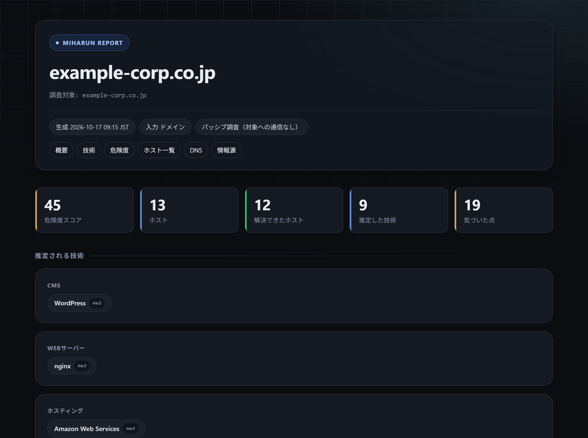
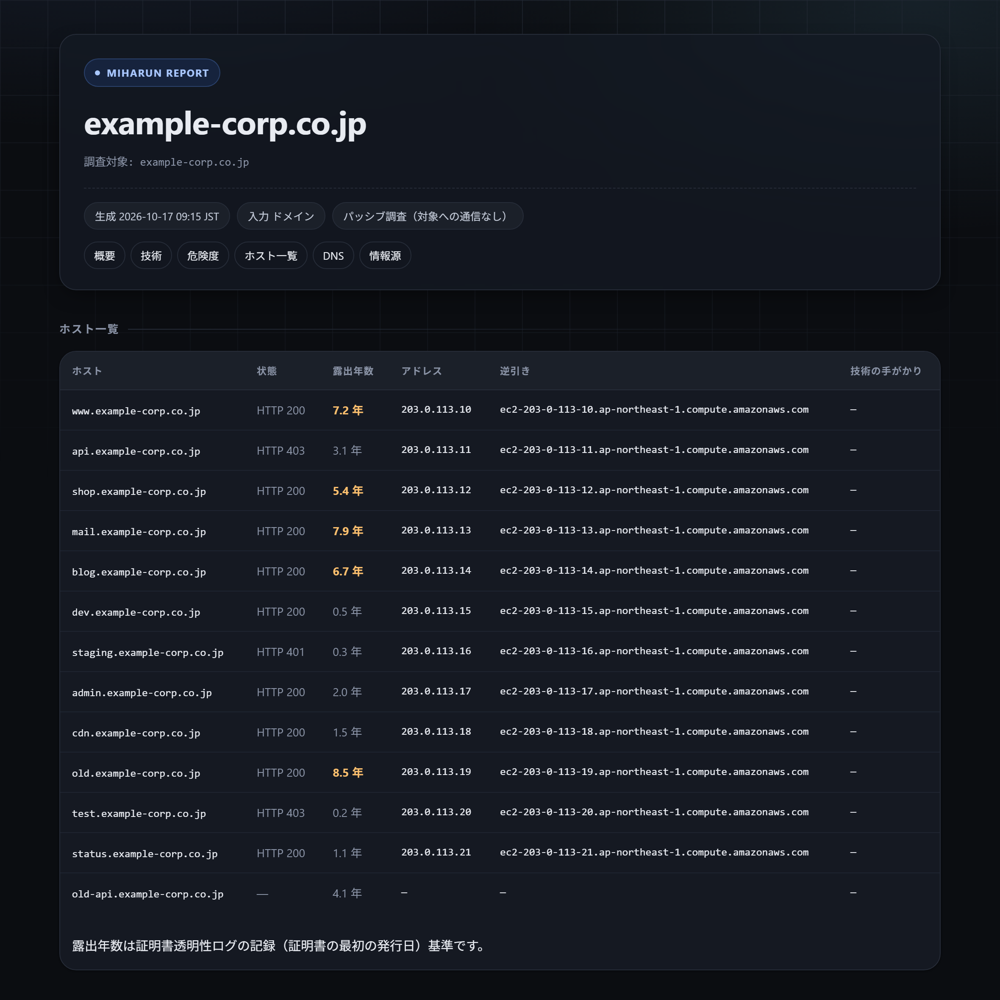
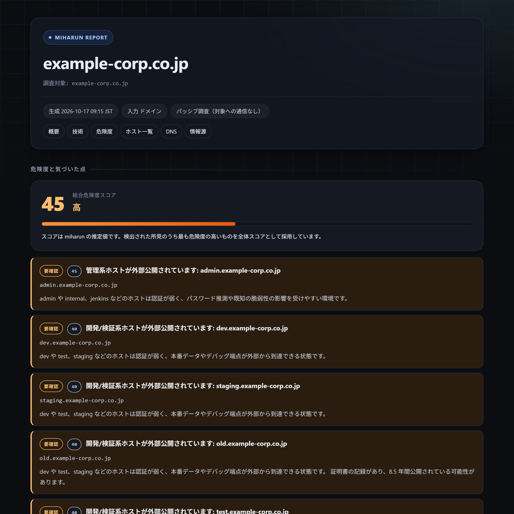

# miharun（みはり）

**企業名かドメインを入れると、その組織が「外からどう見えているか」を日本語の地図にするツール。**

[](https://www.python.org/)
[](LICENSE)
[](pyproject.toml)
[](https://github.com/ul5fc/miharun/actions/workflows/ci.yml)



---

## これは何か

`miharun` は、公開情報だけを使って「組織の外部公開マップ」を作ります。

```console
$ miharun example.co.jp
$ miharun 株式会社サンプル
```

読み取るのは次の 3 つだけです。

| 情報源 | 何が分かるか |
|---|---|
| 証明書透明性ログ（crt.sh） | 公開されているサブドメイン・**いつから公開されているか** |
| DNS（DNS over HTTPS） | A / AAAA / MX / NS / TXT / CNAME / PTR |
| `--probe` 指定時の HTTP 応答 | 応答ヘッダ（`Server` など）・`<title>`・**Web 技術の指紋** |

**既定では対象ホストに 1 バイトもリクエストを送りません。**
`--probe` を付けたときだけ HTTP 応答を取りに行きます（robots.txt を確認し、1 ホスト 1 回だけ）。

> 脆弱性を探すツールではありません。**「意図しないものが外部に公開されていないか」**に気づくための地図です。

---

## できること

### 1. 露出年数 — 「いつから公開されているか」

証明書透明性ログは証明書の発行日を記録しています。そこから
**そのホストが少なくとも何年間公開され続けているか**を算出します。

```
www.example-corp.co.jp     7.2 年
old.example-corp.co.jp     8.5 年   ← 8年半、手が入っていない可能性
dev.example-corp.co.jp     0.5 年
```

**「7 年間放置されている」は、「今 dev 環境がある」より深刻な情報です。**



### 2. 危険度スコア（0〜100）

ホストごとに危険度を採点し、いちばん高いものを総合スコアにします。

| スコア | 条件 | なぜ危ないか |
|---|---|---|
| 45 | `admin` / `internal` / `jenkins` などが名前解決できる | 管理画面が外部から到達でき、推測攻撃の影響を受けやすい |
| 40 | `dev` / `test` / `staging` などが名前解決できる | 本番データやデバッグ端点が露出している可能性 |
| 25 | HTTP 401 / 403 が返る（認証の向こうに API） | 認証を突破されると内部 API に到達できる |
| 20 | 5 年以上公開されている | 長期間更新が止まっている可能性 |

**名前解決できないホストは「公開されている」とは言えないため、採点対象外です**（誤検知を避けるため）。



### 3. Web 技術の自動判定（1,800 種類以上）

`--probe` を付けると、HTTP 応答ヘッダ・読み込まれる JavaScript の置き場所・
HTML の指紋から、使われている技術を判定します。

```console
$ miharun example.com --probe

  推定される技術
    - [CDN・WAF] Cloudflare (high)
    - [DNS] Cloudflare (high)
    - [セキュリティ] DMARC 設定あり (high)
    - [CDN] Cloudflare (medium)
```

上の 4 行は `example.com` への実測です。1・2 行目は NS レコード、
3 行目は TXT レコード、4 行目は `Server` ヘッダから判定しています。
本文やヘッダに手がかりが多いサイトでは、CMS や JS フレームワーク、
解析タグなども検出されます。

判定データは [Wappalyzer（enthec/webappanalyzer・MIT）](https://github.com/enthec/webappanalyzer)
の署名データから自動生成しています（`scripts/build_web_rules.py`）。
**1,800 種類以上の技術 / 66 カテゴリ / 2,200 件のルール**を、
依存ライブラリゼロで判定します。

| 分類 | 判定できるもの（抜粋） |
|---|---|
| CMS | WordPress / Drupal / EC-CUBE / Movable Type |
| EC | WooCommerce / BigCommerce / PrestaShop |
| Webサーバー | nginx / Apache / LiteSpeed / IIS / Caddy |
| JSフレームワーク | React / AngularJS / Alpine.js / Backbone.js |
| ホスティング | Bluehost / Hetzner / Hostinger |
| 静的ホスティング | GitHub Pages / Netlify / Vercel / Heroku |
| 決済代行 | PayPal / Square |
| セキュリティ | DMARC 設定あり / reCAPTCHA |
| レンタルサーバー | さくら / エックスサーバー / ロリポップ / ConoHa（DNS から） |

> **誤検知対策**（実際に踏んだ不具合を直した結果です）
>
> * HTML タグ名や `og:image` のようなどこにでも現れる語はパターンから除外
> * HTTP ヘッダの**名前**（`Host`・`platform`・`Node` など）は、
>   本文の文字列としては使いません。これらは「**その名前のヘッダの値**」が
>   一致したときだけ判定します（`HTTP_HEADER`）
> * 本文に `platform: hostinger` のようなヘッダ行を書いても判定されません
>
> ただし機械的な推定である以上、**誤検知はゼロではありません**。
> レポートにも「推定」であることを明記しています。

### 4. 変化検知（`--diff`）

一度見るだけではなく、**「前回と比べて増えていないか」を定期実行する**のが本来の使い方です。

```bash
miharun example.co.jp --json          # まずベースラインを保存
# 1 週間後
miharun example.co.jp --json --diff   # 増えたホスト・上がった危険度を報告
```

```console
  前回との比較
    危険度スコアの変化: +15
    新規ホスト: 2
      - staging.example.co.jp
    新規の危険度: 1
      - staging.example.co.jp — 開発/検証系ホストが外部公開されています
```

比較を終えた**あとで**ベースライン（JSON）を更新するため、
`--json` と `--diff` は同時に指定してかまいません。

### 5. CI 連携（`--fail-on`）

危険度スコアが閾値以上になったら、**終了コード 1** で異常終了します。

```yaml
# .github/workflows/surface.yml
- name: 公開状態を監視
  run: miharun example.co.jp --json --fail-on 40 --out reports
```

「公開状態が放置されていないか」を自動で見張れます。

---

## インストール

依存ライブラリはありません。Python 3.10 以上があれば動きます。

```bash
git clone https://github.com/ul5fc/miharun.git
cd miharun
python -m miharun example.com
```

コマンドとして使う場合:

```bash
pip install -e .
miharun example.com
```

---

## 使い方

```bash
# ドメインで調べる
miharun example.com

# 企業名で調べる（法人番号 / gBizINFO のキーが必要）
miharun 株式会社サンプル

# HTML と JSON も出力する
miharun example.com --html --json

# HTTP 応答も見る（自分の資産・許可を得た対象のみ）
miharun example.com --probe

# 前回と比較する
miharun example.com --json --diff

# 日本語ドメインもそのまま書ける（内部で punycode に変換）
miharun 例え.テスト
```

入力の判定は次のとおりです。`http://` 付きの URL はホスト名だけを取り出し、
末尾のドット（`example.com.`）は落とします。日本語ドメインは punycode
（`xn--...`）に変換してから問い合わせます。

### 主なオプション

| オプション | 説明 |
|---|---|
| `--html` | HTML レポートを出力（ダークテーマ・印刷対応） |
| `--json` | JSON を出力（`--diff` の基準にもなる） |
| `--out DIR` | 出力先ディレクトリ（既定 `out`） |
| `--probe` | HTTP 応答を取得して Web 技術を判定（既定は取得しない） |
| `--no-subdomains` | サブドメイン列挙を行わない（高速） |
| `--resolve-limit N` | 名前解決するホスト数の上限（既定 150） |
| `--workers N` | 並列数 |
| `--timeout SEC` | 1 回の待ち時間（既定 10 秒） |
| `--diff` | 前回の JSON と比較して変化を報告 |
| `--fail-on SCORE` | スコアが閾値以上なら終了コード 1 |
| `--no-color` | 色を使わない |

---

## 出力例

`example.com`（RFC 2606 で**例示用**と定められたドメイン）への実測です。
値は時期やネットワークによって変わります。

```console
$ miharun example.com

miharun 0.1.0 - 外部公開マップを作成します
  対象: example.com

  証明書透明性ログを照会しています…
  6 件のホストを確認しています…

example.com の外部公開マップ

  A    104.20.23.154, 172.66.147.243
  NS   hera.ns.cloudflare.com, elliott.ns.cloudflare.com

  見つかったホスト: 7 件（うち名前解決可 3 件）

  危険度スコア: 20/100 （中）  ####................

  推定される技術
    - [CDN・WAF] Cloudflare (high)
    - [DNS] Cloudflare (high)
    - [セキュリティ] DMARC 設定あり (high)

  気づいた点
    ・長年公開され続けているホスト: example.com [危険度 20]
    ・長年公開され続けているホスト: www.example.com [危険度 20]

  レポートを出力しました:
    out\miharun-example.com-report.md
```

Markdown / HTML / JSON のレポートには、ホスト一覧・DNS レコード・技術判定・
**露出年数**・**危険度スコア**・**気づいた点**（日本語）が入ります。

サンプルはコマンド 1 つで生成できます（ネットワークに接続しません）。

```bash
python examples/make_example.py    # examples/out/ に出力
```

---

## 企業名で調べる場合の準備

法人名からドメインを特定するには、無料の API キーが必要です（どちらか一方で構いません）。

**方法 A: gBizINFO（経済産業省）— おすすめ**

1. https://info.gbiz.go.jp/ で登録する
2. 発行されたトークンを環境変数に入れる

```powershell
# PowerShell（現在のセッションだけ有効）
$env:GBIZINFO_TOKEN = "あなたのトークン"
```

```bash
# macOS / Linux
export GBIZINFO_TOKEN="あなたのトークン"
```

**方法 B: 国税庁 法人番号システム Web-API**

1. https://www.houjin-bangou.nta.go.jp/webapi/ で利用申請する
2. 発行された ID を環境変数 `HOUJIN_APP_ID` に入れる

> 環境変数を設定しない限り、企業名での調査は動きません。
> ターミナルを開き直すと消えるので、その都度設定してください。

---

## 判定ルールを追加する

DNS から判定するルールは `src/miharun/rules.py` の 1 行です。
**これがいちばん簡単なコントリビューションです。**

```python
Rule(
    "メール",                        # 分類
    "例のメールサービス",             # 表示名
    ("example-mail.jp",),            # 判定に使う文字列（小文字で部分一致）
    ("MX",),                         # どのレコードを見るか
    "high",                          # 確度（high / medium / low）
)
```

追加したらテストを足して、全部通ることを確認してください。

```bash
python -m unittest discover -s tests -t .
python scripts/check_text_health.py --strict
```

くわしくは [CONTRIBUTING.md](CONTRIBUTING.md) を参照してください。

---

## 安全性

**自分の資産、または許可を得た対象にのみ使用してください。**

- 既定では対象ホストにリクエストを送りません
- ポートスキャン・総当たり攻撃は実装していません
- `--probe` は robots.txt を尊重し、レート制限を行います
- 見つけた「管理されていない公開状態」は、悪用せず**所有者へ報告**してください

詳細は **[docs/SAFETY.md](docs/SAFETY.md)** にまとめています。
情報源の一覧と仕様メモは **[docs/SOURCES.md](docs/SOURCES.md)** にあります。

---

## ファイル構成

```
miharun/
├── README.md
├── CONTRIBUTING.md          コントリビューションガイド
├── CHANGELOG.md
├── LICENSE                  MIT
├── pyproject.toml
├── src/miharun/
│   ├── cli.py               コマンド入口
│   ├── console.py           標準出力の文字コード調整（全入口で使用）
│   ├── models.py            データ構造
│   ├── rules.py             日本向け技術判定ルール（手書き）
│   ├── rules_web.py         Web 技術ルール（Wappalyzer 由来・自動生成）
│   ├── fingerprint.py       判定ロジック
│   ├── matching.py          パターン照合の高速化
│   ├── insights.py          日本語の所見生成
│   ├── diff.py              変化検知
│   ├── report_md.py         Markdown レポート
│   ├── report_html.py       HTML レポート
│   ├── safety.py            レート制限・robots.txt
│   └── sources/
│       ├── dns.py           DNS over HTTPS
│       ├── crtsh.py         証明書透明性ログ
│       ├── company.py       法人番号 / gBizINFO
│       └── http_probe.py    HTTP 応答（--probe 時のみ）
├── tests/                   161 テスト（ネットワーク不使用）
├── scripts/
│   ├── build_web_rules.py   Web ルールの生成
│   └── check_text_health.py 文字化け検査（CI で実行）
├── examples/make_example.py サンプルレポートの生成
└── docs/
    ├── SAFETY.md
    ├── SOURCES.md
    └── images/              README 用のスクリーンショット
```

---

## 開発

```bash
# テスト（ネットワークを使いません）
python -m unittest discover -s tests -t .

# 文字化け・文字混入の検査
python scripts/check_text_health.py --strict
```

CI では、日本語を出力できない文字コード（`cp1252`。Windows の英語環境の既定）
でも各入口が落ちないことを確かめています。Windows で日本語が化ける場合は、
この検査と同じ条件で再現できます。

pytest を使う場合:

```bash
pip install -e ".[dev]"
pytest
```

---

## ライセンス

MIT License — 詳細は [LICENSE](LICENSE) を参照してください。

Web 技術の判定データは [enthec/webappanalyzer](https://github.com/enthec/webappanalyzer)（MIT）に由来します。

---

## English

**miharun** builds a Japanese-language "external surface map" of an organization
from a **company name** or a **domain**, using only public information.

- **Passive by default** — it never sends a request to the target host unless you
  explicitly pass `--probe`.
- **Japan-focused** — detects XSERVER, Sakura Internet, lolipop, ConoHa,
  Trend Micro Email Security, EC-CUBE, BASE, colorme, Jimdo, and more.
- **Zero dependencies** — runs on the Python 3.10+ standard library alone.
- **Tells you how long** — it computes how many years each host has been publicly
  visible, from certificate transparency records.

```bash
python -m miharun example.co.jp
python -m miharun example.co.jp --html --json --probe
```

Please use it only on assets you own or have written permission to examine.
See [docs/SAFETY.md](docs/SAFETY.md).
